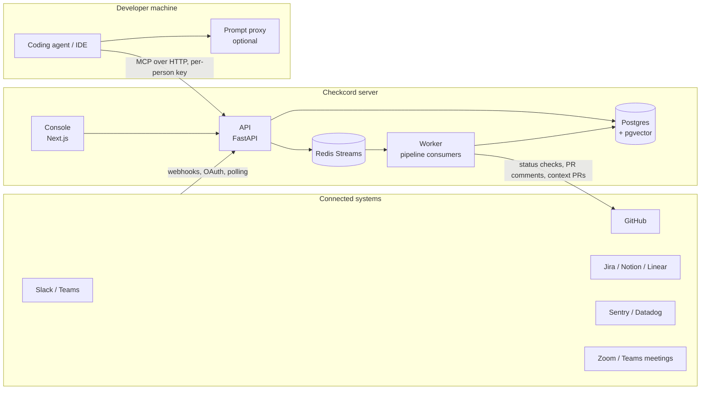
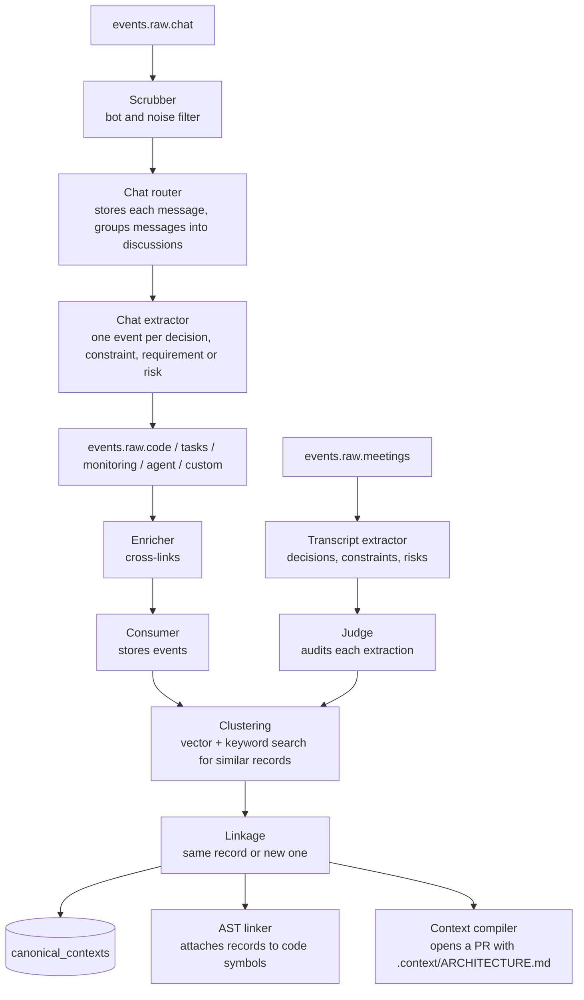

# Architecture

Checkcord copies decisions and constraints out of the tools a company already uses, stores them once, and serves them to AI coding agents and to pull requests. This page describes the moving parts and how data flows between them.

## Processes

A deployment has four processes and two data stores.

| Process | Started with | Role |
|---|---|---|
| API | `checkcord api` | Receives webhooks and OAuth callbacks, exposes the ingestion, graph, SCIM and admin APIs and the MCP endpoint at `/mcp`, runs scheduled jobs and the pull-request workers |
| Worker | `checkcord worker` | Consumes Redis Streams and turns raw events into records |
| Console | `web/` | The admin console: sign-in, overview, records, review, replacements, connections, audiences, people, keys, audit, pipeline and the code graph. People without admin rights see the graph and their account |
| Prompt proxy (optional) | `checkcord proxy start` | Runs on a developer machine between a coding agent and its model provider |

The API on its own accepts and stores events but does not process them. The worker must be running for anything to become a record.

You can run several API and worker processes against one Postgres and one Redis. Scheduled jobs take a Postgres advisory lock and claim each run in the `scheduled_jobs` table, so each job runs once per interval whichever process gets there first. Workers share Redis consumer groups. Rate limits are counted in Redis. See [self-hosting.md](self-hosting.md#scaling).

Both processes serve `/healthz` (alive) and `/readyz` (Postgres, Redis and the migration head), and `/metrics` when `METRICS_ENABLED` is set. The worker serves them on port 9100.

## Ingestion pipeline

Every connector converts its payload to a `CanonicalEvent` and publishes it to a raw stream. The worker moves events through these stages.

- **Scrubber** drops bot messages and off-topic chatter before anything else spends tokens on them.
- **Chat router** stores every kept message as an event (source id `chat-message:{channel}:{message id}`, under the normal event retention) and then adds it to a discussion. A discussion holds messages from one tenant, platform and channel only, keeps the message ids, threads, authors and times, and the most restrictive audience seen across its messages. A reply joins the discussion that holds its thread, or one created for the thread when the first message has not arrived; a first message that arrives later joins it too. Top-level messages wait in a channel buffer until `CHAT_BUFFER_MAX_MESSAGES` have arrived or `CHAT_BUFFER_TIMEOUT_SECONDS` have passed, then the router model assigns them to a discussion of the channel or a new one. A message leaves the buffer only once it is in a discussion, and the same message is never added twice.
- **Chat extractor** takes a discussion once it has been quiet for `CHAT_DISCUSSION_IDLE_SECONDS`. It asks the extraction model what the discussion settled: decisions, rules or constraints, requirements and accepted risks, each citing the messages it rests on. Each outcome is checked in code: names, numbers and identifiers in it must appear in the cited messages (a statement that fails is replaced by the longest cited message, a detail that fails is dropped). Then `CHAT_SETTLED_MODEL` is asked, for each statement, whether the discussion settled it or left it open: a proposal, a question, an objection nobody resolved or an argument with no conclusion is open. Whether something was settled is that model's judgement. An open outcome, or one whose answer cannot be read after one retry, is dropped and counted ("Outcomes dropped as not settled" in `checkcord stats`); when the model cannot be reached the discussion waits as for extraction. Each outcome is published to `events.raw.custom` as its own Slack or Teams event with source id `chat-tree:{discussion}:{n}`, the statement and its details as text, the channel's audience, and a `chat_source` block that cites the cited messages and every message of the discussion. It becomes an `adr`, `constraint`, `business_requirement` or `risk` record. A discussion that settled nothing publishes nothing and is counted.
- **Nothing is lost.** The extractor claims a discussion for 120 seconds instead of removing it, and deletes it only after every outcome event is published; the event store ignores a second copy of the same source id, so a retry after a crash adds no duplicate. When the model cannot be reached, times out or answers 5xx or 429, the discussion waits `min(30 s × 2^attempts, 15 min)` and is retried without limit. After five unusable replies it is parked; `checkcord events failed` lists parked discussions and `checkcord events retry` queues them again. `checkcord stats` shows how many chat messages wait to be grouped, how many discussions wait and how many are parked, and `checkcord doctor` warns when one has waited over 10 minutes with an error, or when messages have waited too long to be grouped.
- **Edits and deletions.** A Slack or Teams edit replaces the stored text; a deletion removes the stored message (both write an audit entry without the text). Either one, and a purge by event, source or person that removes a chat message, rebuilds the discussions it was part of: their outcome events are purged, so their records are deleted or take another base event, and the remaining messages are queued again as one discussion, due at once.
- **Clustering** embeds the event and searches existing records with vector similarity and full-text search, fused by reciprocal rank. An optional reranker reorders the candidates.
- **Linkage** decides whether the event belongs to an existing record. It first compares identifiers found in both texts (ticket keys, PR numbers), then asks an LLM for one of three verdicts per candidate, nearest first: `SAME` (the event joins the record), `CHANGES` (it is about the same subject but changes the decision, so it starts a new record that may replace that one) or `DIFFERENT` (try the next candidate). A reply that is none of the three is asked once more, then counts as a failed call. If the LLM call fails and no other candidate matched, the event is retried and finally sent to a dead-letter stream. It is never turned into a new record by default, because that would create duplicates.
- **Review.** An event saved while its connection is in review is held: it carries `held_connection`. Clustering only offers candidates held under the same connection, or live ones for a live event, and linkage checks this again in its write transaction. A held event that matches nothing makes a held record. Held records get no `contexts.created`, so no code links and no context files. A deferred constraint trigger refuses any link between held and live material.
- **Evidence score** is stored when an event is linked, in the same transaction, and recomputed on a schedule from source weights, confirmations sent through the push API, and age. The score is a weighted count of supporting events by source type that decays with age; it is not a probability. Records decay after a grace period unless something refreshes them.

Failed messages are retried, reclaimed from crashed consumers, and moved to `<stream>.dlq` after repeated failures. A dead-letter entry keeps the original fields plus a `dlq_error` field. Stored credentials are removed and keys in the error text are redacted. `checkcord dlq replay` puts an entry back on its stream without the error field.

### Store first, embed after

The consumer commits each event before it calls the embedding model, so a model outage cannot lose an event. The row tracks its progress in `pipeline_state`:

- `pending`: saved, not yet embedded and handed to clustering.
- `done`: embedded and published to `events.clustering.pending`.
- `failed`: the embedding step kept failing for 24 hours. `checkcord events retry` puts it back to `pending`.

If the embedding call fails, the message is still acknowledged and the row keeps the error and the next attempt time. Every `WORKER_SWEEP_INTERVAL_SECONDS` the worker retries due rows. The wait doubles from 30 seconds up to one hour. A worker takes the row with `SELECT ... FOR UPDATE SKIP LOCKED` and holds the lock during the call, so two workers never process the same event at once. A redelivered message for a saved but unfinished event continues the work; one that is `done` changes nothing. Later stages keep the bus retry and dead-letter path.

### Stream trimming

Producers do not cap stream length, because a cap can drop entries nobody has read yet. On the same interval the worker trims each stream to the oldest entry that some consumer group has not acknowledged. Entries still pending for a group, or not yet delivered to it, are kept. A stream with no group is not trimmed. Dead-letter streams are never trimmed; empty them with `checkcord dlq replay` or `checkcord dlq drop`.

## Code graph

`ast/parser.py` uses Tree-sitter to extract classes, functions and imports from Python, TypeScript, JavaScript, Go and Java. Each symbol is stored as an `ast_nodes` row with a content hash. Symbols are populated in two ways:

- a full walk of the repository when it is connected (`POST /api/v1/admin/repos/connect`)
- an incremental update when a pull request merges

`ast_context_edges` links a record to the symbols it is about. These edges drive three features: the pull-request check, the console's graph, and staleness detection (an edge untouched for 180 days in an active repository is proposed for removal through a pull request).

## Pull-request guardrail

When GitHub reports a pull request, the PR worker finds the changed symbols and the records linked to them, and fetches the patch (at most 30 files, 6,000 characters a file and 24,000 in all). The status reporter takes those records plus the newest 20 blocking records that are org-wide or scoped to the repository, and in `judge` mode asks `PR_CHECK_MODEL` whether the diff conflicts with, complies with or is unrelated to each. A conflict with a blocking record fails the check; an advisory one is cited in the comment. The first status is pending, "Checkcord is checking this change." A judgement that fails, an internal error, or a check still unfinished after 15 minutes is retried twice, a minute apart, while the status stays pending; then the status is `error` (or, with `PR_CHECK_ON_ERROR=success`, a success that says "Not evaluated: internal error."). The check never passes a change it did not judge. In `touch` mode no model is called and a blocking record attached to changed code fails the check. Checkcord keeps one comment per pull request and edits it on each push. New records are advisory. An admin changes this with `PATCH /api/v1/admin/records/{id}/severity` or `checkcord records severity`, and each change is audited.

The comment quotes a record if it is public, or if the repository is private and every collaborator on it may see the record under the audience rule below. Other records still count toward the check but are listed without their content. The same rule decides what goes into the generated `.context/ARCHITECTURE.md`.

## Review

Each connection has a state, live or in review, keyed `provider:identifier` (for example `jira:acme.atlassian.net`, `github:owner/name`, `custom:push`). Agent logs have no connection and are always live. A connection seen for the first time starts in review when `REVIEW_NEW_CONNECTIONS` is true.

Held rows are hidden by row-level security unless the transaction sets `app.include_held`. Only the pipeline, purges, audience upkeep and the admin review endpoints set it. Releasing a connection clears `held_connection` on its events and records in one transaction and publishes `contexts.created` for each record, so code links and context files follow the usual path. Rejecting goes through the purge.

## Record lifecycle

A record is live or retired. Retired records have `retired_at` set and are hidden by a restrictive row-level security policy unless the transaction sets `app.include_retired`. Only admin reads, purges, redaction upkeep and stats set it. So every serving path, the PR check, the context compiler and clustering skip retired records without their own filter. Stale-edge cleanup removes a record's link to a symbol, not the record; a record stays live until an admin retires it.

Suggested replacements are stored in `record_replacement_suggestions`, one row per older and newer record, with the basis (`stated` or `model`). Linkage writes a suggestion when it starts a new record from a live event and the older record is live and in the same scope. The basis is `stated` when the event says it replaces an earlier decision; the older record is then the closest candidate and no model is asked. The basis is `model` when the linkage verdict was `CHANGES`; the older record is that candidate, and the two types must be compatible (equal, or both among `adr`, `constraint` and `business_requirement`; a record with no type counts as `general`). An open suggestion is not acted on until an admin accepts or dismisses it. Until then each read path that serves the older record adds `may_be_replaced_by` (the newer record's id, creation time, basis and the first 200 characters of its summary), but only when the reader may read the newer record.

A record's summary is the text of the event that started it, redacted. Later events that join the record do not change the summary. Each one is counted, and unless it only restates the record (the same text once case and punctuation are ignored, or a vector similarity of 0.97 or more), its text is kept on its link row in `context_event_links` as an update excerpt: at most 600 characters, cut at a sentence or word boundary, redacted like a summary. The origin event has no excerpt. Each MCP result serves up to three updates, newest first; the record page and `checkcord records show` show up to twenty; the PR comment and the context file show the latest. Reads never call a model. An excerpt goes wherever its link row goes: linking an event recomputes the record's audience in the same transaction, so a narrower event narrows the record before its excerpt can be served, and a purge by source, event or person deletes the link row and its excerpt. The record page, `checkcord records show` and each MCP result also give `supporting_events`: how many events are linked and the dates of the first and last. A later event that changes the decision is not merged: it starts a new record and a replacement suggestion, so the old summary is never shown as current once the change is accepted.

## Scopes

A record applies to the whole organization, a team, a repository or a path. Scope rows carry a priority so the more specific rule wins. Scope changes go through `PATCH /api/v1/admin/records/{id}/scope` and are recorded in an audit table.

## Access control and redaction

- Every table that holds tenant data has row-level security keyed on `app.current_tenant`.
- Each event records who could see it in the source system (channel members, repository collaborators, meeting attendees), or what an admin set for its connection. A record takes the audience of its base event, plus anyone an admin granted access to one of its events. Linkage only joins an event that does not widen that audience. The stored audience is recomputed when a grant changes, or the audience of the base event's channel, repository or connection changes. Reads made on behalf of a person are filtered to what that person may see, by row-level security on `app.current_user_id`; a caller with no person attached sees only public content.
- Personal data is redacted when a record summary is stored. The linkage worker runs a model pass and a pattern pass, and writes the result to `summary_redacted` with a `redaction_version` of the rules and model. If the model pass fails, it stores the pattern-only text and sets `redaction_pending`; the worker sweep retries those rows. Update excerpts are stored the same way, with their own version and pending flag on the link row. `checkcord redaction recompute` redoes summaries and excerpts on an older version, in batches.
- Read paths (the graph API, the MCP tools, pull-request comments and context files) serve `summary_redacted` with the pattern pass run again, or the pattern pass over `summary` when no copy is stored. They never call a model. Event text in node details, agent ledger and skills content and the proxy's context file get the pattern pass only. An admin key can read unredacted content through a separate endpoint, and each such read is logged.

### Model usage

The chat model factory attaches a callback that counts each call. The embedder and the reranker are timed the same way. Counts are keyed by organization, day, kind, purpose and model, held in memory, and added to `model_usage` about once a minute by the worker and the API, and on shutdown. The organization comes from the event being processed or the key making the request. Counts with no known organization go to `DEFAULT_TENANT_ID`, or are dropped with a warning. Prompts and replies are never kept.

### Audience refresh

Slack channels, Teams conversations and GitHub repositories each have one row in `audience_containers`: public or not, the matched member ids, and when it was last read. Each event from one of them names it in `events.audience_container`.

- **Ingestion.** A connector uses the stored row while it is fresh, instead of calling the provider. Otherwise it reads the provider and stores the result first. The consumer also copies the row's audience onto each event as it saves it, so an event built before a refresh does not bring back the old audience.
- **Triggers.** The API's scheduler reads every row each `AUDIENCE_REFRESH_INTERVAL_MINUTES`. Slack membership and visibility events and GitHub `member` and `repository` webhooks refresh one row at once. `checkcord audiences refresh` does it by hand.
- **Applying a change.** The new audience is written to the row, to every event of that container, and to every record linked to those events, recomputed from all of its events with the usual rule. Up to `AUDIENCE_REFRESH_BATCH_SIZE` events this is one transaction. Larger containers are done in batches of that size: first every event is narrowed to the readers allowed by both the old and the new audience, then the new audience is applied. So no batch lets anyone read something they could not read before and cannot read after. Each batch locks the row, and stops if a later refresh has stored a different audience.
- **Failures.** A failed read keeps the last good audience for `AUDIENCE_REFRESH_GRACE_HOURS`, then stores an empty one. The error is kept on the row.
- **Generated files.** When a refresh narrows a record, or changes a repository's audience, the worker's context compiler regenerates `.context/ARCHITECTURE.md` for the tenant's connected repositories through its usual path.

A refresh that changes an audience writes an `audience.refreshed` audit entry with counts only.

[security.md](security.md) covers this in detail, including what is not enforced yet.

## Developer side

- **MCP** (`/mcp` on the API, streamable HTTP, authenticated with a per-person API key): three tools. `get_dependency_flow` lists the symbols in a file, `view_active_decisions` returns the decisions in scope for a repository, team or path, and `search_conceptual_context` runs a semantic search. Each result includes its sources, a content hash and the time it was last verified. `checkcord mcp` offers the same tools over stdio for clients that need it and forwards each call to `/mcp`.
- **Prompt proxy** (`checkcord proxy start`): sits between a coding agent and the model provider. It keeps the `.context/` rules at a stable position in the prompt to improve cache hits, warns when another active branch has changed a symbol the prompt touches, and records token usage locally. `checkcord proxy metrics` prints the totals.

## Data model at a glance

| Table | Holds |
|---|---|
| `events` | Every canonical event, partitioned by week. `connection` names the connection it came through |
| `canonical_contexts` | One row per decision, constraint or risk, with embedding, evidence score, severity, type, the event it was made from, and its stored redacted summary |
| `context_event_links` | Which events support which record, with each update's stored redacted excerpt |
| `context_repo_scopes` | Scope rows for a record |
| `ast_nodes`, `ast_context_edges` | Code symbols and their links to records |
| `enterprise_users`, `chat_users` | Identities, provisioned through SCIM, directory sync and sign-in. `enterprise_users.is_admin` makes a person's sessions admin |
| `scim_groups`, `scim_group_members` | Groups pushed over SCIM and their members. Used only for `SCIM_ADMIN_GROUPS` |
| `*_installations` | Connector credentials per tenant |
| `api_keys` | Hashed API keys, each optionally bound to a person |
| `user_sessions` | Browser sign-in sessions, stored as a hash of the token, with idle and absolute expiry |
| `audit_log_entries` | One row per read of record content, admin action or rejected key, with the key, person and record ids. The app role can only add and read rows |
| `context_scope_audit_log` | Each scope change with its before and after values, for the scope history endpoint |
| `audience_containers` | One audience per Slack channel, Teams conversation and GitHub repository, and when it was last read |
| `model_usage` | Model calls, failures, tokens and latency per organization, day, kind, purpose and model. No content |
| `connection_reviews` | Whether each connection is in review. `events.held_connection` and `canonical_contexts.held_connection` name the connection a row is held under |
